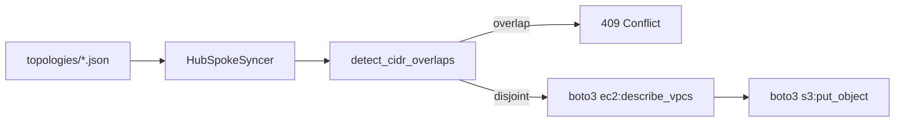
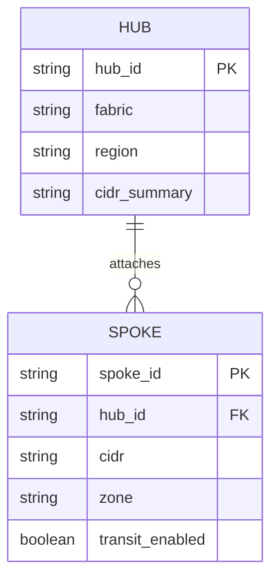

# Design Notes: Hub-and-Spoke Across AWS Transit Gateway, Azure vWAN and GCP NCC

This service loads hub-and-spoke definitions from `topologies/aws-tgw`, `topologies/azure-vwan`, and `topologies/gcp-ncc`, checks spoke CIDR overlap and OPA route/window rules, queries AWS EC2 VPCs via `boto3`, and writes route snapshots to S3.

## Data Flow and Transformation Pipeline

## Hub and Spoke Schema

## Edge Cases and Limitations

Replay checks and UTC change windows evaluate against UTC epoch time so Daylight Saving Time changes do not shift allowed hours. When `window_extension.enabled` is true with `extra_minutes` up to 15 and a `change_id` of at least 4 characters, off-window updates are permitted for `net-eng` or `sre-oncall`. AWS calls retry throttling and HTTP `429`/`502`/`503`/`504` responses with per-retry sleep capped at `2.0s`.

Limitations: Azure vWAN and GCP NCC hubs are represented as declarative topology files in `topologies/` rather than calling Azure or GCP SDKs directly, and `describe_vpcs` does not paginate beyond the initial page.
